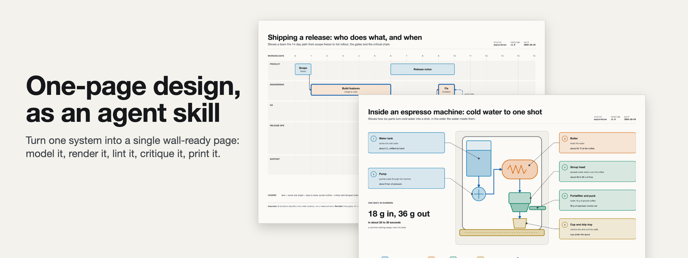
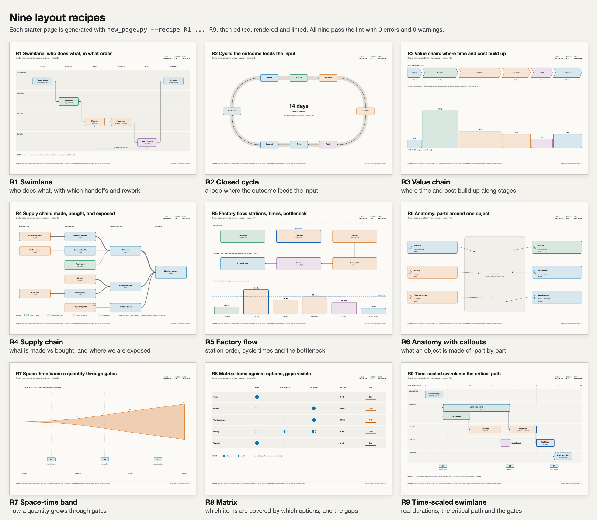
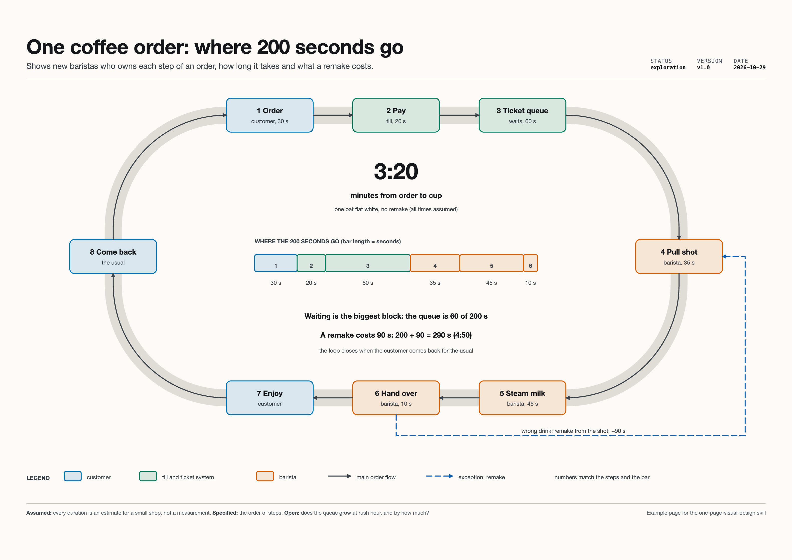
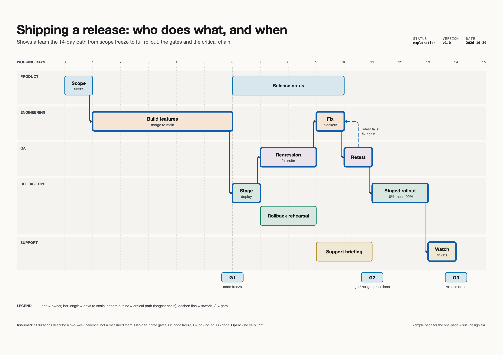
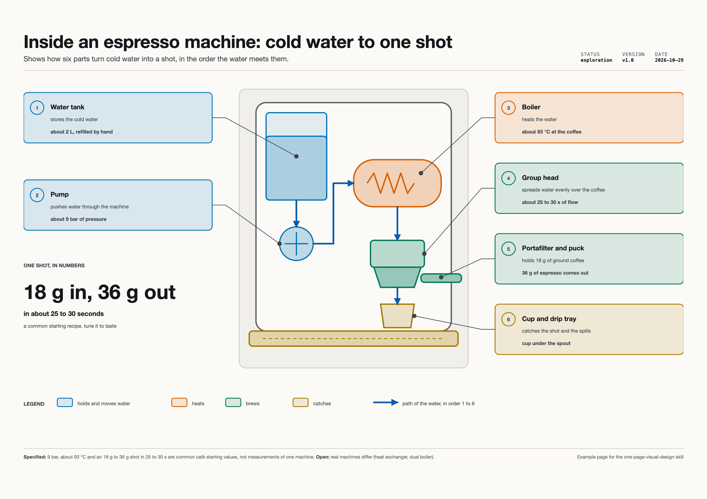

# one-page-design-skill



> **Based on Stone Librande's One-Page Designs** (talk "One Page Design Philosophy", while creative director at EA Maxis): [watch the video](https://youtu.be/E9_wLks1kAg). The idea and the method are his; this repo packages them as an agent skill. Not affiliated with or endorsed by Stone Librande or Electronic Arts.

An agent skill that turns one bounded system (a process, a cycle, a supply chain, a product, a roadmap) into a single wall-ready page: an editable HTML and SVG diagram, rendered, linted, critiqued and exported as PNG and PDF from A4 to A1.

## What is a one-page design?

Stone Librande's idea: instead of a long document that chops a design into sections, put the whole model on one page. People read headlines and pictures, not long text, and a single page shows how the parts **connect**. A good page has a title that says why it exists, plenty of white space, one main illustration or diagram in the middle, short callouts around it, and three tiers of information (glance, label, detail). You print it, hand it over and write on it. This skill encodes those principles (paraphrased, with timestamps into the talk in `references/one-page-principles.md`) as a step-by-step workflow with quality gates.

## When to use it, and when not

Use it for: process maps, production or delivery cycles, value and supply chains, factory flow, product anatomy, roadmaps, game or UX systems, "a poster for the wall", visual specs.

Do not use it for: prose executive summaries, single-page websites, slide decks, data dashboards, or decorative posters with no explanatory model.

## Features

- **Render, lint, critique loop.** `render.py` drives headless Chrome (standard library only), exports PNG, tiles, zoomed regions and a vector PDF; `lint_page.js` checks type size, contrast, text overflow, connectors, SVG scale, whitespace and density. The agent must look at the render before it claims success.
- **Print sizes A4 to A1**, landscape or portrait, with type floors per sheet and a one-page PDF check.
- **Light and dark themes**, WCAG contrast, colour-blind-safe palette, meaning never by colour alone.
- **Brand tokens**: link a project's `tokens.css` and logo, with fallbacks.
- **Nine layout recipes (R1 to R9)** plus a generator: `new_page.py --recipe R1 ... R9` or `--spec schedule.json` for a time-scaled swimlane with the critical path computed from data.
- **Quality gates G1 to G10** and four operating modes (discovery, exploration, reference, revision) plus an unattended mode.



## Install

Requirements: Python 3.8+ and Google Chrome or Chromium (tested on macOS; poppler is optional for PDF checks).

```bash
git clone https://github.com/sometimeswedie/one-page-design-skill.git
cd one-page-design-skill

# Claude Code (all projects; or use <project>/.claude/skills/)
cp -r one-page-visual-design ~/.claude/skills/

# Codex
cp -r one-page-visual-design ~/.codex/skills/
```

Quick check that the tooling works (writes outside the skill folder):

```bash
python3 one-page-visual-design/scripts/render.py examples/coffee-order/coffee-order.html --out /tmp/opd-check --strict
```

## Example prompts

- "Use the one-page-visual-design skill to map our order-to-delivery process as an A3 swimlane, with the rework loop."
- "Make a one-page visual of how our release pipeline works, time-scaled, with the critical path and gates."
- "Draw a product anatomy page for this device, callouts around one illustration, print-ready at A2."
- "Review this one-pager and list what fails the quality gates."

## Gallery

All examples were built with the skill's own workflow (`new_page.py`, edit, `render.py`, `lint_page.js`) and pass the lint with 0 errors and 0 warnings. Every number on them is labelled as assumed or specified on the page itself. HTML sources, PNG (light and dark) and PDF are in each folder.

| | |
|---|---|
| **Coffee shop: one order, end to end** (cycle). Who owns each step, how long it takes, what a remake adds. |  |
| **Shipping a software release** (time-scaled swimlane). Lanes, gates, critical path, rework. Generated from `release-spec.json`. |  |
| **Inside an espresso machine** (anatomy with callouts). Six parts in the order the water meets them. |  |

## Repository layout

```
one-page-visual-design/      the skill (install this folder)
  SKILL.md                   workflow, gates, reference map
  references/                principles, grammars, recipes, render loop, print, brand
  assets/                    page-template.html, recipes R1-R9, lint fixture
  scripts/                   new_page.py, render.py, lint_page.js, lanes_gantt.py
  agents/openai.yaml         Codex UI metadata (ignored by Claude Code)
  CHANGELOG.md
examples/                    three example pages (HTML source + PNG + PDF)
docs/images/                 README images, UG ALK mark
```

## Credits

- **Stone Librande**: originator of the one-page design idea and method. This skill is based on his talk "One Page Design Philosophy" ([video](https://youtu.be/E9_wLks1kAg)); the principles here are paraphrased and credited to him.
- **UG ALK**: skill packaging, tooling and examples.

  

Not affiliated with or endorsed by Stone Librande or Electronic Arts.

## License

[MIT](LICENSE), Copyright (c) 2026 UG ALK.
